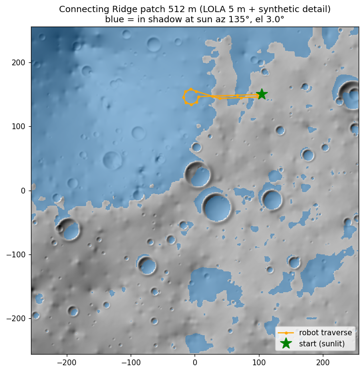

# Lunar South-Pole SLAM Demo

A simulated rover drives from sunlight into a deep shadow at **Connecting Ridge** (an Artemis III
candidate landing region at the lunar south pole) and back again, building a 3D map and tracking its
own position the whole way, including in the dark.

Built with **ROS 2 Jazzy**, **Gazebo Harmonic** and **RViz 2**, on real NASA LOLA terrain.



**Latest result** (`run_20261114_182623`):

| | |
|---|---|
| Distance driven | 265.4 m |
| Final position error | **0.25 m** (0.09 % of distance) |
| Worst position error | 0.70 m |
| Map size | 231 643 points (21 % coloured by the camera) |
| Camera frames | 3080, of which 60 % in shadow |
| Visual tracking | OK 100 % (in sunlight and in shadow) |

---

## Contents

1. [The idea in one minute](#1-the-idea-in-one-minute)
2. [Quick start](#2-quick-start)
3. [Gazebo: the simulated Moon and rover](#3-gazebo-the-simulated-moon-and-rover)
4. [SLAM: how the rover knows where it is](#4-slam-how-the-rover-knows-where-it-is)
5. [ORB: what the camera does](#5-orb-what-the-camera-does)
6. [RViz: what you see on screen](#6-rviz-what-you-see-on-screen)
7. [Data flow (all ROS topics)](#7-data-flow-all-ros-topics)
8. [Output files](#8-output-files)
9. [What we did: project history](#9-what-we-did-project-history)
10. [Stability and performance](#10-stability-and-performance)
11. [Repository layout](#11-repository-layout)
12. [Development, tests and CI](#12-development-tests-and-ci)
13. [Limitations and honest notes](#13-limitations-and-honest-notes)

---

## 1. The idea in one minute

At the lunar south pole the Sun stays only a few degrees above the horizon, so ridges and crater
rims throw very long shadows. A rover (or an astronaut) entering those shadows loses daylight, and
there is no GPS on the Moon. It still has to know where it is, map the ground and find its way back.

This demo tests that situation:

1. **Gazebo** simulates a 512 m × 512 m patch of real south-pole terrain with a sun 3° above the
   horizon, and a rover with a LiDAR, a camera with a headlamp, an IMU and wheel encoders.
2. A **route driver** drives the rover from a sunlit start, deep into the shadow, around a loop and
   back.
3. **LiDAR-inertial SLAM** estimates the rover's pose (position + orientation) from the sensors only
   and builds a 3D map. This works in total darkness, because a LiDAR brings its own light.
4. An **ORB camera tracker** finds and follows visual features, shows whether the camera can still
   "see" (sunlight vs. headlamp only), colours the map with real camera brightness, and places camera
   features in 3D using LiDAR depth.
5. **RViz** shows the map growing live, with the SLAM path drawn next to the true path so you can
   see the error directly.

---

## 2. Quick start

**Needs:** Ubuntu 24.04, `ros-jazzy-desktop`, `ros-jazzy-ros-gz`, `ros-jazzy-rqt-image-view`,
`wmctrl`, and ideally an NVIDIA GPU.

```bash
git clone <this repo> lunar_slam_demo && cd lunar_slam_demo
python3 -m venv --system-site-packages venv
venv/bin/pip install -r requirements.txt
./run_demo.sh
```

The first start builds the terrain and rock meshes from the stored heightmap (about 3 seconds).
A run takes about 5 minutes and ends by itself.

| Command | What it does |
|---|---|
| `./run_demo.sh` | full run: Gazebo window + RViz 3D map + ORB camera view |
| `./run_demo.sh gui:=false` | without the Gazebo window (lightest on the GPU) |
| `./run_demo.sh speed:=1.2` | faster rover (m/s, default 0.9) |
| `./run_demo.sh --viewers` | reopen the windows for a run that is still going |
| `./run_demo.sh --status` | is a run going? where is its log? |
| `./run_demo.sh --stop` | stop a run (results are still saved) |
| Ctrl+C | stop the run (results are still saved) |

---

## 3. Gazebo: the simulated Moon and rover

Gazebo is the physics and sensor simulator. It runs **headless** (no window) in the "core" part of
the demo and renders the camera and LiDAR images off-screen on the GPU. The Gazebo window you see is
only a viewer connected to it.

### The terrain (`worlds/south_pole.sdf`, built by `tools/make_world.py`)

- **Real elevation data:** a 512 m × 512 m crop of NASA's LOLA *Site04* digital elevation model
  (5 m per pixel), centred in the Connecting Ridge region.
- **Robot-scale detail added:** the 5 m data is upsampled to 1 m, then synthetic detail is added
  where no real data exists at that scale: fractal roughness, 260 small craters and **5000 rocks**.
  The rocks are placed densely along the route, so the camera and LiDAR always have something to
  see.
- **Lunar conditions:** gravity 1.62 m/s², no atmosphere (black sky, almost no ambient light) and
  a **sun 3° above the horizon** casting real shadows from the terrain geometry.
  `config/shadow_mask.png` records which ground is in shadow.
- **Two versions of the ground:** a *heightmap* for physics (what the wheels drive on) and a
  *triangle mesh* for rendering (what the camera and LiDAR see), both from the same heights.

### The rover (`models/rover/model.sdf`)

A 60 kg, four-wheel, skid-steer rover (wheel radius 0.25 m, track 0.9 m):

| Sensor | Details | Used for |
|---|---|---|
| **LiDAR** (`gpu_lidar`) | 900 × 32 beams, 360° × 34° view, 0.8–60 m range, 10 Hz, 1 cm noise | main SLAM sensor |
| **Camera** | 640 × 480, 74° field of view, 10 Hz, tilted 14° down | ORB tracking, map colour |
| **Headlamp** | spot light, ~12 m useful range | lets the camera see in shadow |
| **IMU** | 100 Hz, tactical-grade gyro (noise + small bias) | rotation between scans |
| **Wheel odometry** | from the drive plugin | distance travelled |
| **Ground truth** | perfect pose, 30 Hz | **only** for the start pose, the error readout and steering |

### The route (`nodes/route_driver.py`)

15 waypoints from `config/terrain_meta.json`: start in sunlight → drive about 110 m into the
shadow → drive a 12 m-radius loop deep in the shadow → return along a parallel line to the start
(about 265 m in total). The driver stands in for an operator walking a planned route. It steers
with the ground-truth pose, which the SLAM never sees.

---

## 4. SLAM: how the rover knows where it is

SLAM = **S**imultaneous **L**ocalization **A**nd **M**apping: the rover estimates where it is
from its own sensors, and builds a map at the same time, each helping the other.

The SLAM runs in `nodes/slam_node.py --role lidar`, with the maths in `nodes/p2pl_icp.py`.
For every LiDAR scan (10 per second):

```
 IMU gyro ──► rotation since last scan ─┐
                                        ├─► motion PRIOR (a first guess)
 wheels  ──► distance since last scan  ─┘            │
                                                     ▼
 LiDAR scan ─► downsample (0.35 m voxels) ─► point-to-plane ICP against the local map
                                                     │  (refines the guess, ≤10 iterations)
                                                     ▼
                                              new rover pose
                                                     │
              ┌──────────────────────────────────────┼──────────────────────────┐
              ▼                                      ▼                          ▼
   add scan to the local map          add scan to global 3D map        publish pose, path,
   (after every scan)                 (every 0.4 m, coloured by        TF, live scan
                                       the camera where lit)
```

**Step by step:**

1. **Motion prior.** Before matching, the node predicts how the rover moved since the last scan.
   - *Rotation* comes from integrating the IMU gyroscope, which is very accurate over short times.
   - *Distance* comes from the wheel odometry, which is good but wheels slip in regolith.
2. **Scan matching with point-to-plane ICP.** ICP (*Iterative Closest Point*) moves the new scan
   until it lines up with the map built so far.
   - For each scan point it finds the nearest map point, and measures the distance along that map
     point's **surface normal** (distance to the local plane, not to the point).
   - *Why point-to-plane:* lunar ground is smooth. With plain point-to-point ICP the scan rings
     "slide" along flat ground and the pose drifts. Point-to-plane makes flat ground fix height,
     roll and pitch exactly, and stays neutral along the surface. Rocks, crater rims and slopes then
     fix the remaining directions.
   - The optimisation is **damped towards the prior**. Where the terrain gives no information (for
     example along a flat featureless stretch), the IMU/wheel guess holds the pose instead of letting
     it wander. Robust weighting reduces the influence of bad matches.
3. **Local map.** A rolling map within 50 m of the rover is used for matching. It stores one point
   per 0.25 m cube, with a surface normal and a "planarity" score per point, and is updated after
   every scan.
4. **Global map.** Every 0.4 m of travel, the points within 40 m are added to a voxel map (one point
   per 0.25 m cube).
   - Each point is coloured by **camera brightness** if the camera saw it lit (within 30 m).
   - Otherwise it is coloured by **height** (blue → violet → magenta), meaning "LiDAR only".
5. **Start pose.** The very first pose is the known landing site (as a real crew would know it).
   After that, ground truth is used only to **measure** the error, never to correct it.

**Why it works in the dark:** the LiDAR, IMU and wheels need no light. The camera is extra
information, not something the pose depends on.

---

## 5. ORB: what the camera does

The camera runs in its own process: `nodes/slam_node.py --role camera`.

**ORB** (*Oriented FAST and Rotated BRIEF*) is a fast feature detector: it finds corner-like spots
in an image (rock edges, crater rims, pebbles) and gives each one a binary "fingerprint" so it can
be recognised in the next frame. It is the front end used by the well-known ORB-SLAM systems.

For every camera frame (10 per second):

1. **Auto-exposure.** The image is brightened by up to 8× based on how dark the ground is. This is
   what makes headlamp-only images usable.
2. **Detect ORB features:** up to 1200 per frame, over 8 scales.
3. **Match to the previous frame** by fingerprint (Hamming distance), then reject wrong matches
   geometrically. A matching pair must fit one consistent camera motion (essential matrix with
   RANSAC).
4. **Tracking state** from the number of surviving matches:

   | State | Matches | Meaning |
   |---|---|---|
   | `OK` | ≥ 60 | camera clearly sees and follows the ground |
   | `WEAK` | 20–59 | barely trackable |
   | `LOST` | < 20 | camera cannot follow the scene |

5. **Lighting state.** The rover's SLAM position is looked up in the shadow map, which gives
   `SUNLIT` or `IN SHADOW - headlamp only`. Statistics are kept separately for shadow frames.
6. **Camera + LiDAR fusion ("lifting").** The LiDAR points are projected into the image to get a
   depth for each tracked ORB feature (within 25 m). With that depth and the SLAM pose, each feature
   becomes a **3D point** (the red "ORB map points" in RViz).
7. **HUD image** (`/slam/orb_image`, shown in the camera window):
   - orange circles = detected features
   - green lines/boxes = features tracked from the previous frame
   - text overlay = tracking state, LiDAR SLAM status, distance, live error against truth, exposure
     gain and lighting

The LiDAR node also uses the camera image: it colours map points with the brightness the camera saw
(section 4, step 4).

> **Honest scope:** this is ORB *tracking and feature mapping*, not a full ORB-SLAM3. The camera does
> not estimate the rover pose here, the LiDAR-inertial SLAM does. The camera adds map colour, 3D
> feature points and a live measure of whether vision would still work in the shadow. In this run it
> stayed `OK` 100 % of the time, also in shadow, but only within the headlamp's ~12 m range.

---

## 6. RViz: what you see on screen

`./run_demo.sh` opens three windows, tiled automatically:

```
┌───────────────────────┬───────────────────────────────────┐
│  Gazebo (top left)    │                                   │
│  rover in the terrain,│        RViz (right)               │
│  camera follows it    │        live 3D SLAM map           │
├───────────────────────┤                                   │
│  ORB camera view      │                                   │
│  (bottom left)        │                                   │
└───────────────────────┴───────────────────────────────────┘
```

**RViz displays** (`config/lunar_slam.rviz`, all in the `map` frame):

| Display | Topic | What it shows |
|---|---|---|
| 3D map | `/slam/map` | the global map: **grey/white** = seen lit by the camera, **blue→magenta** = LiDAR only (shadow, or outside the camera view) |
| ORB map points | `/slam/orb_points` | **red** = camera features placed in 3D with LiDAR depth |
| Live LiDAR scan | `/slam/scan` | **yellow** = the current scan, placed at the SLAM pose |
| SLAM path | `/slam/path` | **orange** = where SLAM thinks the rover went |
| Ground truth path | `/ground_truth/path` | **green** = where it really went (the gap to orange is the error) |
| Rover | `/slam/rover` | **yellow box** = rover at the SLAM pose |

To keep the GPU load low, RViz gets a **display copy** of the map: one point per 0.5 m, at most
120 000 points, sent every 2 s and only when it changed. The saved `map.ply` keeps full resolution
(0.25 m).

**Gazebo window:** the rendered scene. The camera follows the rover; the play/pause control is in
the corner.

---

## 7. Data flow (all ROS topics)

```
                       ┌──────────── Gazebo (headless) ────────────┐
                       │  terrain · sun · rover · sensors · physics │
                       └───────────────┬──────────────▲─────────────┘
                                       │ ros_gz_bridge│ /cmd_vel
    /lidar/points  /camera/image  /imu  /wheel_odom  /ground_truth/odom  /clock
          │              │          │        │              │
          ▼              ▼          ▼        ▼              ▼
   ┌───────────────────────────────────────────────┐   ┌──────────────┐
   │ lidar_slam  (slam_node.py --role lidar)       │   │ route_driver │──► /cmd_vel
   │  in : lidar, imu, wheel_odom, camera image,   │   │ (uses ground │──► /route/status
   │       ground_truth (start + error only)       │   │  truth only) │
   │  out: /slam/odom /slam/path /slam/map         │   └──────────────┘
   │       /slam/scan /slam/rover /slam/status TF  │
   └──────────────────────┬────────────────────────┘
                          │ /slam/odom, /slam/status
                          ▼
   ┌───────────────────────────────────────────────┐
   │ camera_orb  (slam_node.py --role camera)      │
   │  in : camera image, lidar, SLAM pose          │
   │  out: /slam/orb_image /slam/orb_points        │
   │       /slam/vis_status                        │
   └───────────────────────────────────────────────┘
                          │
                          ▼
            RViz · rqt_image_view · Gazebo GUI  (viewers only)
```

All nodes use simulation time (`/clock`). The topic bridge is defined in `config/bridge.yaml`.

---

## 8. Output files

Each run writes `results/run_<date>_<time>/`:

| File | Content |
|---|---|
| `summary.txt` | distance, final and worst error, map size, camera/shadow statistics |
| `map.ply` | full coloured 3D map (opens in CloudCompare / MeshLab) |
| `orb_points.ply` | 3D ORB feature points |
| `slam_traj.txt`, `gt_traj.txt` | SLAM and true trajectory in TUM format `t x y z qx qy qz qw` (works with the `evo` tool) |
| `core.log`, `viewers.log` | logs of the simulation/SLAM part and the windows |

Compare trajectories with, for example: `evo_ape tum gt_traj.txt slam_traj.txt -a --plot`.

---

## 9. What we did: project history

1. **Terrain.** Built the world from the LOLA Site04 5 m DEM: chose the Connecting Ridge patch,
   picked a sun direction that puts a large shadow near the centre, added craters, roughness and
   rocks, and planned a sunlit start and a target deep in the shadow.
2. **Rover and simulation.** Rover model with LiDAR, camera + headlamp, IMU and wheel odometry;
   bridged to ROS 2; route driver.
3. **SLAM.** Developed the LiDAR-inertial SLAM described in section 4.
   - An early run (`run_20261114_155909`) ended with **185 m** error over 270 m.
   - Runs with the current point-to-plane ICP + IMU/wheel prior stayed under about **0.4 m**.
     The best so far is **0.25 m** over 265 m.
4. **Camera.** ORB tracking with auto-exposure, a shadow-aware HUD, camera colouring of the LiDAR map
   and LiDAR-depth lifting of features.
5. **Crash (14 Nov 2026, 17:57).**
   - During a run the desktop's display server (Xorg) crashed inside the NVIDIA graphics driver.
     The desktop restarted, the terminal closed, and that killed the run.
   - The SLAM code was not at fault. The GPU was carrying a heavy load at the time: the full
     300–400 k point map re-uploaded to RViz every second, a ~1 M-triangle scene with shadows drawn
     in three programs, and GPU-rendered sensors.
   - The fixes are in section 10. The next run completed with no crash and the best result so far.
6. **Repository for GitLab.**
   - Split the launch into core and viewers, and made the runner crash-proof.
   - Moved the voxel map into its own testable module.
   - Made the 63 MB of meshes reproducible instead of committing them.
   - Added tests, lint, CI and this README.
   - Fixed two shutdown bugs found while testing: an orphaned bridge process, and Ctrl+C being
     ignored.

---

## 10. Stability and performance

**The run does not depend on the desktop.** `run_demo.sh` starts two parts:

```
run_demo.sh
 ├─ core  (own session, detached from the desktop) ── launch/core.launch.py
 │    Gazebo server (headless, sensors rendered off-screen via EGL)
 │    bridge · spawn rover · lidar_slam · camera_orb · route_driver
 │    ends by itself ~8 s after the route is complete, after saving results
 └─ viewers (foreground) ─────────────────────────── launch/viewers.launch.py
      Gazebo GUI · RViz · ORB camera view   (can be closed and reopened at any time)
```

If the display crashes again, the windows disappear but the run continues and saves its results.
Reopen the windows with `./run_demo.sh --viewers`. (`launch/demo.launch.py` still starts everything
in one process tree, without this protection.)

**Less GPU load:**

- RViz gets the decimated map (section 6) instead of the full map every second.
- The windows run with vsync, so they redraw at the screen refresh rate, not as fast as possible.
- The window-tiling script no longer calls `xrandr`, which made the NVIDIA driver re-probe the
  display outputs.

**Performance mode:** for the duration of a run, `run_demo.sh` sets the `performance` power profile
and NVIDIA PowerMizer "prefer maximum performance", then restores the previous settings.

**Tip:** close browser tabs that use WebGL (for example map viewers) before a run; they share the GPU.

---

## 11. Repository layout

```
run_demo.sh            one-command runner (core + viewers, performance mode, --stop/--viewers/--status)
launch/
  core.launch.py       headless Gazebo + bridge + rover + SLAM + camera + route driver
  viewers.launch.py    Gazebo GUI + RViz + ORB camera view
  demo.launch.py       both in one launch
  _common.py           shared paths and environment (vsync, PRIME offload)
nodes/
  slam_node.py         LiDAR-inertial SLAM (--role lidar) and ORB camera tracker (--role camera)
  p2pl_icp.py          point-to-plane ICP with motion prior, rolling local map
  voxel_map.py         coloured voxel map + display decimation (no ROS, unit-tested)
  route_driver.py      drives the planned route
tools/
  make_world.py        DEM → world; --from-assets rebuilds meshes without the DEM
  tile_windows.sh      arranges the three windows
config/
  bridge.yaml          Gazebo ↔ ROS topic bridge
  lunar_slam.rviz      RViz layout
  gz_gui.config        Gazebo window layout
  terrain_meta.json    patch size, height range, sun, spawn pose, waypoints
  shadow_mask.png      which ground is in shadow
  rocks.csv            5000 rock positions/sizes (to rebuild rocks.obj)
  meshes.md5           checksums of the generated meshes
models/
  rover/model.sdf      the rover and its sensors
  lunar_patch/         heightmap + regolith textures (meshes/ is generated)
worlds/south_pole.sdf  the world: physics, lunar gravity, sun, terrain, rocks
preview/               terrain preview image
tests/                 unit tests (NumPy/SciPy only, no ROS needed)
```

**Not in git** (see `.gitignore`):
- `venv/` (recreate with the Quick start commands)
- `results/` (run outputs)
- `.devdata/` (recorded bags, several GB)
- `models/lunar_patch/meshes/` (63 MB, rebuilt byte-identically; CI checks this)
- DEM GeoTIFFs

### Rebuilding the world from the DEM

Only needed to change the site, sun, rocks or route. Needs `Site04_final_adj_5mpp_surf.tif` from
NASA PGDA ("High-resolution LOLA topography for lunar south pole sites"):

```bash
venv/bin/python tools/make_world.py --dem /path/to/Site04_final_adj_5mpp_surf.tif   # ~30 s
md5sum models/lunar_patch/meshes/*.obj > config/meshes.md5                            # if changed
```

---

## 12. Development, tests and CI

```bash
venv/bin/python -m pytest          # 10 unit tests: voxel map, ICP, mesh generation
ruff check .                       # lint (settings in pyproject.toml)
```

GitLab CI (`.gitlab-ci.yml`) runs on every push:

| Job | Checks |
|---|---|
| `lint` | ruff, shell syntax |
| `unit-tests` | pytest (JUnit report shown in merge requests) |
| `mesh-rebuild` | meshes rebuild byte-identical to `config/meshes.md5` |
| `launch-files` | all launch files load, in the official `ros:jazzy-ros-base` image |

---

## 13. Limitations and honest notes

- **Simulation, not flight data.** The large-scale terrain is real (LOLA). Craters below ~5 m,
  roughness, rocks and the regolith texture are synthetic.
- **Ground truth use:** start pose, error measurement and the route driver's steering. The SLAM
  itself never sees it.
- **No loop closure.** The SLAM is odometry against a local map; error grows slowly with distance.
  It returns to the start with 0.25 m error here, but a much longer traverse would need loop closure.
- **The camera does not estimate pose** (see section 5). A full visual or visual-LiDAR SLAM would
  be the next step.
- **The headlamp limits vision in shadow** to about 12 m; beyond that only the LiDAR sees.
- **Graphics driver:** the 14 Nov crash was in the NVIDIA driver. The demo is now protected against
  it, but if it happens again, a stable driver version is the real fix.
